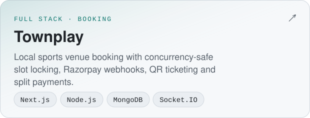
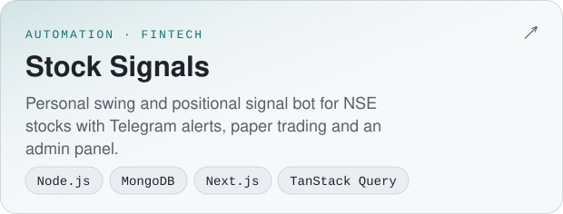
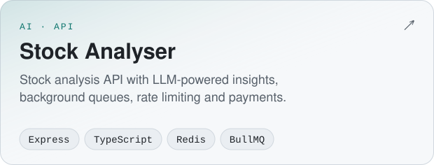
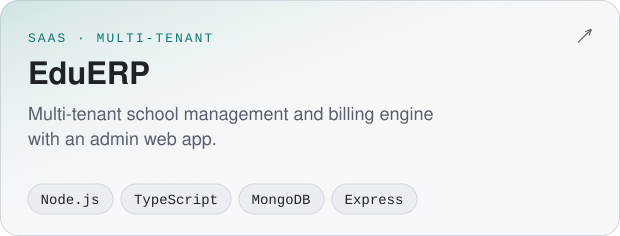
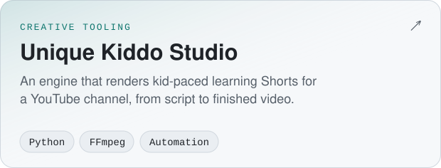
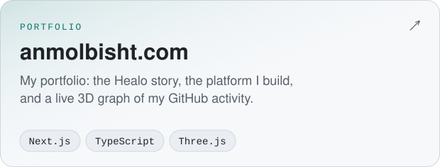

<a href="https://anmolbisht.com">
  <picture>
    <source media="(prefers-color-scheme: dark)" srcset="assets/banner-dark.svg">
    
  </picture>
</a>

  
  
  

<picture>
  <source media="(prefers-color-scheme: dark)" srcset="assets/stats-dark.svg">
  
</picture>

## About me

I'm a **Lead Full Stack Engineer at [Infiheal](https://infiheal.com)**, where I lead the web & app team behind **Healo**, a mental-health AI companion used by 2M+ people. I care about chat that feels instant, systems that hold up under load, and products that are gentle with the people using them.

- **Real-time AI chat.** Re-architected Healo's chat streaming on Server-Sent Events with regeneration, deduplication and session recovery. Built **Duo Chat**, a multi-user AI chat room on Socket.IO with presence and crisis escalation.
- **Platform.** A B2B integration platform for enterprise and university partners, 2 published npm SDKs, global payments with Stripe and Razorpay, 5 languages, and voice-to-voice AI conversations.
- **AI pipeline.** I work with the AI team on the conversation pipeline: safety and routing classifiers, crisis flows, RAG, long-term memory and multi-provider LLM failover.
- **Leadership.** I run sprints, code reviews and releases for web, Flutter mobile and desktop, and mentor developers and interns.

## Tech I work with

  
   
  

  <b>Real-time</b> · SSE · WebSockets · Socket.IO · Bot Framework DirectLine · LLM streaming · speech-to-text and text-to-speech 
  <b>AI</b> · LLM APIs · prompt design · classifier routing · RAG · embeddings · Qdrant · conversation memory · guardrails · LLM-as-judge

## Featured work

<table>
  <tr>
    <td width="50%"><a href="https://github.com/anmolbisht2308/Townplay-client"><picture><source media="(prefers-color-scheme: dark)" srcset="assets/card-townplay-dark.svg"></picture></a></td>
    <td width="50%"><a href="https://github.com/anmolbisht2308/stock-signals"><picture><source media="(prefers-color-scheme: dark)" srcset="assets/card-stock-signals-dark.svg"></picture></a></td>
  </tr>
  <tr>
    <td width="50%"><a href="https://github.com/anmolbisht2308/Stock-Analyser-backend"><picture><source media="(prefers-color-scheme: dark)" srcset="assets/card-stock-analyser-dark.svg"></picture></a></td>
    <td width="50%"><a href="https://github.com/anmolbisht2308/eduERP-backend"><picture><source media="(prefers-color-scheme: dark)" srcset="assets/card-eduerp-dark.svg"></picture></a></td>
  </tr>
  <tr>
    <td width="50%"><a href="https://github.com/anmolbisht2308/unique-kiddo-studio"><picture><source media="(prefers-color-scheme: dark)" srcset="assets/card-kiddo-dark.svg"></picture></a></td>
    <td width="50%"><a href="https://anmolbisht.com"><picture><source media="(prefers-color-scheme: dark)" srcset="assets/card-portfolio-dark.svg"></picture></a></td>
  </tr>
</table>

## Activity

  <picture>
    <source media="(prefers-color-scheme: dark)" srcset="https://streak-stats.demolab.com?user=anmolbisht2308&theme=github-dark-blue&hide_border=true&background=0D1117">
    
  </picture>

<picture>
  <source media="(prefers-color-scheme: dark)" srcset="https://raw.githubusercontent.com/anmolbisht2308/anmolbisht2308/output/github-snake-dark.svg">
  
</picture>

Most of my day-to-day work happens in private company repositories, so public activity shows only part of it.

---

Open to conversations about real-time systems, AI products and engineering leadership. <a href="https://www.linkedin.com/in/anmolbisht">Say hi on LinkedIn</a> or visit <a href="https://anmolbisht.com">anmolbisht.com</a>.

